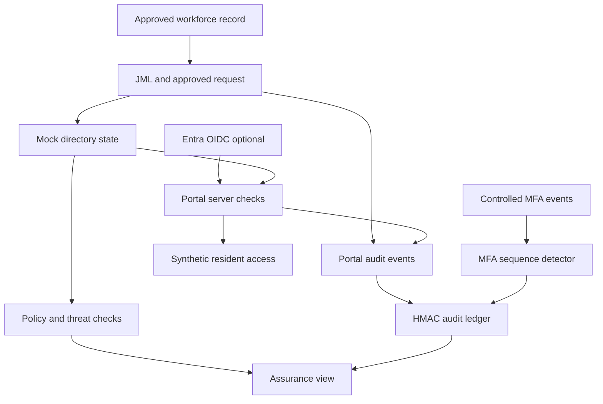

# Version 6 integration architecture

The trust boundary around the browser means it cannot assign itself a role or validate its own device. Server-side role, facility and assignment checks guard the protected pages. The workforce/automation boundary has one approved local state and a simulated directory state. The ledger boundary keeps its signing key and head checkpoint outside the SQLite record set. Authentic Entra, Graph mutation and device management need their own test tenant and separate acceptance evidence.
