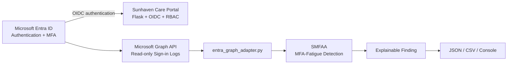
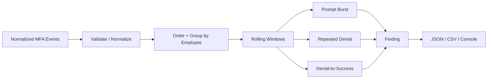

# SMFAA Architecture and Design

## 1. Position in Sunhaven

SMFAA is an operational MFA-fatigue detection service that runs beside the Sunhaven Flask application.



Microsoft Entra ID authenticates users. The Flask application authorises application access. SMFAA independently monitors MFA behaviour using read-only sign-in information.

## 2. Internal Design



The three detection rules use the same normalized event model regardless of whether events originate from the demo dataset, exported Entra evidence, or the live Microsoft Graph connector.

## 3. Current Input Sources

### Demo Source

`data/demo-events.csv` is a controlled dataset used to demonstrate all three detectors.

### Repository Entra Evidence

`evidence/phase6/P6-E14_Entra-SignIn-Sanitized.csv` is read through `entra_csv_adapter.py` when SMFAA is used with the main Sunhaven repository.

### Live Microsoft Entra Source

Live Microsoft Entra integration is implemented through `entra_graph_adapter.py`.

The live runtime flow is:

```text
Microsoft Entra ID Sign-in Logs
        |
        v
Microsoft Graph API
        |
        v
entra_graph_adapter.py
        |
        v
Normalized MFA Events
        |
        v
detector.py
        |
        v
Findings
        |
        v
JSON / CSV / Console
```

The Microsoft Graph connector uses delegated, read-only `AuditLog.Read.All` permission with admin consent and device code authentication.

The connector maps relevant Entra sign-in activity into the normalized event structure expected by the existing detector:

```text
event_id
employee_id
timestamp
event_type
```

Relevant MFA event types are:

```text
MFA_PROMPT
MFA_DENIED
MFA_SUCCESS
```

This design allows the existing detection rules to operate without being rewritten.

## 4. Detection Rules

SMFAA evaluates three MFA-fatigue patterns:

1. **Prompt Burst** - 5 MFA prompts within 2 minutes.
2. **Repeated Denial** - 3 MFA denials within 5 minutes.
3. **Denial-to-Success** - 3 MFA denials followed by a successful MFA event within 10 minutes.

The rule thresholds and time windows are maintained in `config/detection-rules.json`.

## 5. Code Components

| File | Responsibility |
|---|---|
| `src/smfaa.py` | CLI and runtime orchestration |
| `src/detector.py` | Event validation, detection rules and report export |
| `src/entra_csv_adapter.py` | Normalize exported Entra sign-in records |
| `src/entra_graph_adapter.py` | Retrieve and normalize live Entra sign-in records through Microsoft Graph |
| `src/sunhaven_adapter.py` | Read workforce context and map Entra identities |
| `config/detection-rules.json` | Detection thresholds, time windows and severity |
| `data/identity-map.csv` | Map Entra identities to Sunhaven employee identities |

## 6. Microsoft Graph Authentication

The live connector uses a Microsoft Entra App Registration configured for read-only access.

The configuration includes:

- Microsoft Graph delegated permission `AuditLog.Read.All`
- Admin consent granted
- Public client flow enabled
- Device code authentication
- No client secret

The application receives the Client ID and Tenant ID through environment variables:

```text
SMFAA_CLIENT_ID
SMFAA_TENANT_ID
```

Secrets, access tokens and temporary device codes must not be stored in the repository.

## 7. Security Boundary

SMFAA is a read-only monitoring and detection component.

SMFAA can:

- read Microsoft Entra sign-in information;
- identify relevant MFA-related events;
- map Entra identities to Sunhaven employee identities;
- analyse normalized events;
- detect configured MFA-fatigue patterns; and
- produce explainable JSON, CSV and console findings.

SMFAA cannot:

- disable users;
- revoke sessions;
- configure MFA;
- modify Microsoft Entra identities;
- change RBAC;
- execute Joiner-Mover-Leaver actions;
- alter Flask application access; or
- automatically remediate detected findings.

This separation keeps SMFAA focused on detection rather than identity administration.

## 8. Live Validation

The live Microsoft Graph integration has been tested against the Sunhaven Microsoft Entra environment.

The Graph adapter successfully retrieved live sign-in records and converted relevant records into normalized SMFAA MFA events.

A controlled Test Nurse scenario successfully produced a `REPEATED_DENIAL` finding when three MFA denials occurred within five minutes.

The resulting finding was exported through the existing SMFAA reporting process.

## 9. Current Live Limitation

During live testing, successful sign-in records for the test account returned:

```text
authenticationRequirement=None
authenticationDetails=None
```

in the Microsoft Graph response used by the adapter.

The adapter intentionally does not classify every successful `errorCode 0` sign-in as `MFA_SUCCESS`, because a successful sign-in does not necessarily prove that an MFA approval occurred. Automatically classifying all successful sign-ins as MFA successes could therefore create false-positive detection results.

As a result, live **Repeated Denial** detection has been validated.

The **Denial-to-Success** detector remains implemented and can be demonstrated using the controlled demo dataset. Live Denial-to-Success validation is currently limited by the MFA information available in the Graph response used by the connector.

The live connector currently retrieves a limited set of recent Graph records and does not yet implement pagination or persistent token caching.
