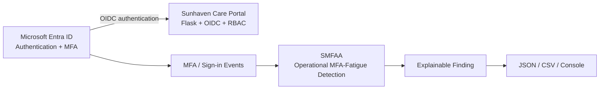
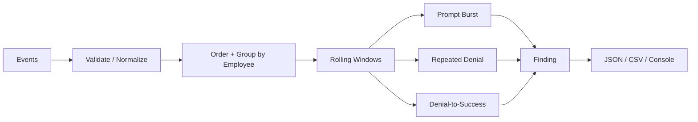

# SMFAA Architecture and Design

## 1. Position in Sunhaven

SMFAA is an operational detection service that runs beside the Sunhaven Flask application.

Entra authenticates. Flask authorises. SMFAA monitors MFA behaviour.

## 2. Internal design

## 3. Current input sources

### Demo source

`data/demo-events.csv` is a controlled dataset used to demonstrate all three detectors.

### Existing repository Entra evidence

`evidence/phase6/P6-E14_Entra-SignIn-Sanitized.csv` is read through `entra_csv_adapter.py` when SMFAA is inside the main repository.

### Live Entra later

A future read-only Graph connector can feed the same normalized event model. The detection code does not need to change.

## 4. Code components

| File | Responsibility |
|---|---|
| `src/smfaa.py` | CLI and runtime orchestration |
| `src/detector.py` | validation, event model, three rules and report export |
| `src/entra_csv_adapter.py` | normalize current Entra export records |
| `src/sunhaven_adapter.py` | read workforce context and map Entra identities |
| `config/detection-rules.json` | thresholds, windows and severity |

## 5. Security boundary

SMFAA can read events, analyse them and produce findings.

SMFAA cannot disable users, revoke sessions, configure MFA, change RBAC, execute JML, alter Flask access or automatically remediate findings.
